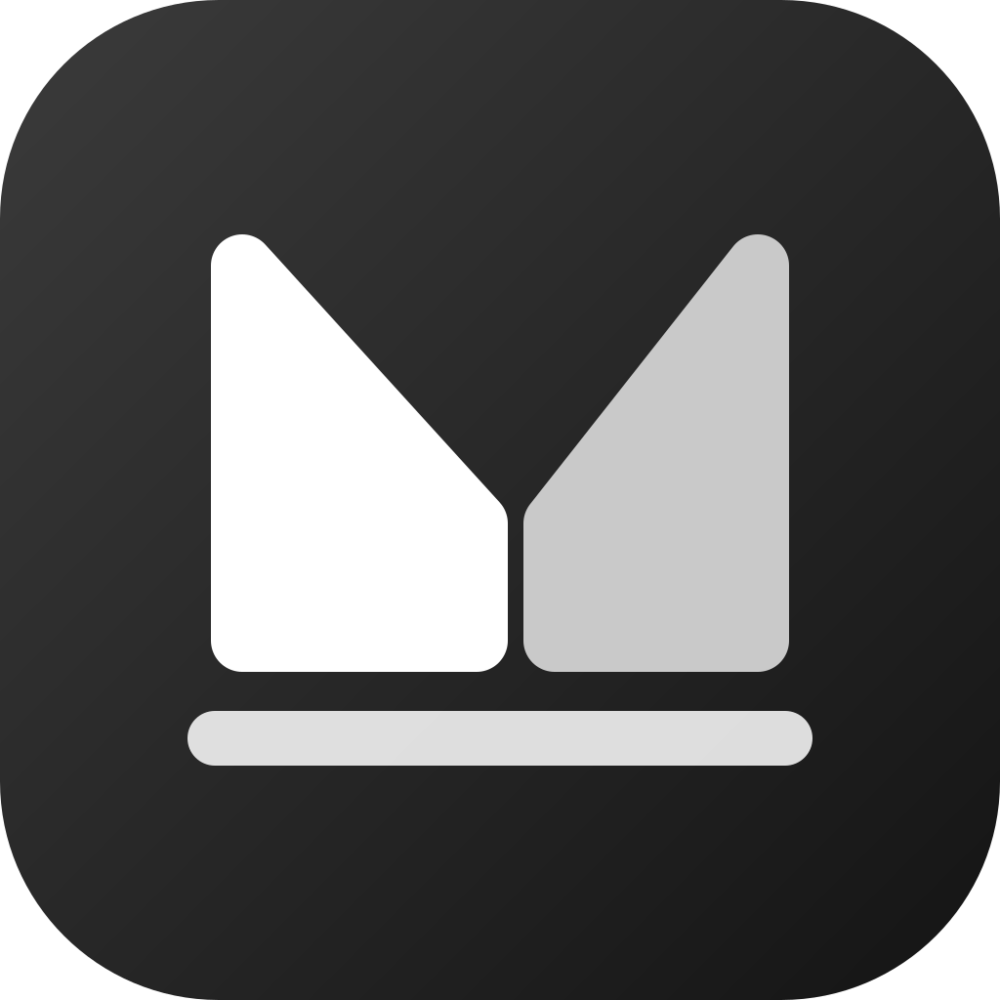

<p align="center">
  
</p>

# Fumandocs

Fumadocs documentation sites with [Mantine](https://mantine.dev) as the UI layer
— without Tailwind CSS.

## Packages

| Package            | npm                                                   | Description                                         |
| ------------------ | ----------------------------------------------------- | --------------------------------------------------- |
| `fumandocs-ui`     | [npm](https://www.npmjs.com/package/fumandocs-ui)     | Mantine UI adapter (layouts, MDX, search, provider) |
| `create-fumandocs` | [npm](https://www.npmjs.com/package/create-fumandocs) | Scaffold a Next.js + Fumadocs MDX + Mantine site    |

## Quick start

```bash
npx create-fumandocs my-docs
cd my-docs
npm run dev
```

Install the UI package directly and import from `fumandocs-ui/...`:

```bash
pnpm add fumandocs-ui @mantine/core @mantine/hooks fumadocs-core fumadocs-mdx
```

When reading [fumadocs.dev](https://fumadocs.dev) guides, replace the package
name **`fumadocs-ui`** with **`fumandocs-ui`** for supported subpaths (see
export-compatibility on the docs site).

## Monorepo development

```bash
pnpm install
pnpm build
pnpm dev:site      # dogfood: apps/www (fumandocs-www)
```

The **only in-repo dogfood app** is `apps/www` (`fumandocs-www`): marketing
homepage, getting-started guides, export-compatibility docs, and MDX component
showcase. Scaffolded apps come from `create-fumandocs` (see
`packages/create-fumandocs/template`).

## License

MIT. The Mantine UI adapter is derived from the Fumadocs project (MIT, Fuma
Nama). See [NOTICE.md](./NOTICE.md).
